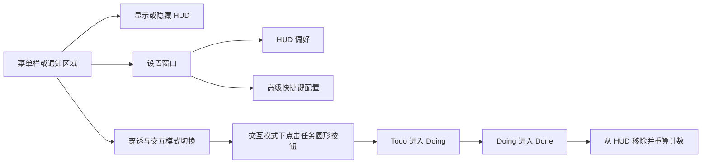

# GhostPin 设计基线

本文供后续 Coding Agent 维护 GhostPin 界面时参考。基线来自 `/Users/jty/project/GhostPin/` 的当前源码，整理日期为 2026 年 11 月 17 日。本文、原型和共用资源的约定存放位置为 `/Users/jty/project/GhostPin/design/`。本次仅写入设计产物，不修改原有业务源码。

## 使用入口

| 文件 | 用途 |
| --- | --- |
| [index.html](index.html) | HUD、菜单与设置的可交互原型，直接用浏览器打开 |
| [components.html](components.html) | 组件状态样本、设计变量说明与状态推进演示 |
| [styles/tokens.css](styles/tokens.css) | 共用字体、颜色、尺寸和动效变量 |
| [styles/components.css](styles/components.css) | HUD、任务行、菜单与设置组件样式 |
| [styles/preview.css](styles/preview.css) | 演示控制区与说明页面的样式，不属于 GhostPin 产品界面 |
| [scripts/model.js](scripts/model.js) | 示例任务、投影排序、日期和状态推进规则 |
| [scripts/components.js](scripts/components.js) | 两个页面共用的组件渲染函数 |
| [scripts/app.js](scripts/app.js) | 主原型事件与页面状态编排 |
| [scripts/catalog.js](scripts/catalog.js) | 组件状态目录编排 |
| [assets/source-baseline.json](assets/source-baseline.json) | 原始文件路径、读取时间与 SHA-256 指纹 |

HTML 使用相对路径和本地资源，不依赖构建工具、CDN、服务端或网络接口。两个页面应连同 `assets/`、`styles/` 和 `scripts/` 一起保留。Markdown 链接在不同浏览器中可能打开文本或下载文件，也可以直接在编辑器中阅读本文。

## 基线原则

1. 继续使用当前设计。macOS 的紧凑列表、系统材质、语义颜色和原生设置层级是基线；Windows 的浅色卡片单独记录。
2. 以当前源码描述实际行为。正式规格用于核对产品意图，发现差异时记录差异，不擅自修复原始仓库。
3. 将原生实现与网页近似值分开。原生系统颜色、材质和 SF Symbols 不应被网页中的固定色值或替代图形反向覆盖。
4. 同一组件只维护一套实现。页面原型和组件目录共用渲染函数与样式，新增状态同时补充文档和样本。

本基线没有新增任务录入、编辑、删除、分组筛选、撤销完成或账号系统。原型外侧的平台、外观、场景、宽度和重置控件属于演示工具，不应移植到产品窗口中。

## 页面结构

GhostPin 是桌面菜单栏应用，主要界面由多个原生窗口与菜单组成，没有普通网站的页面路由。

| 界面 | 结构 | 主要操作 |
| --- | --- | --- |
| 菜单栏 / 通知区域 | 品牌图标、未完成任务数、系统菜单 | 显示或隐藏 HUD、切换交互模式、打开设置、退出 |
| 桌面 HUD | 品牌与计数、Doing 分区、Todo 分区、模式页脚 | 交互模式中推进任务；原生窗口支持移动与调整大小 |
| HUD 设置 | 透明度、范围、条数、窗口行为和通用设置 | 修改偏好后即时影响 HUD |
| 高级设置 | 快捷键开关、组合键录制、清除、状态说明 | 选择性配置模式切换快捷键 |

macOS 的 HUD 默认宽度为 380pt，最小尺寸为 320 × 144pt。首次打开且没有保存尺寸时，窗口按内容计算高度；之后优先使用用户保存的位置和尺寸。设置窗口宽度为 420pt。

Windows 默认逻辑窗口为 360 × 460，使用浅色卡片布局。设置窗口创建尺寸为 420 × 320，原生控件以固定坐标布局。HTML 改用正常文档流，因此设置窗口会按内容展开。

## 核心流程

### 任务投影与状态

- HUD 只展示 `todo` 和 `doing`。`done` 任务立即从 HUD 移除，不提供反向状态按钮。
- Doing 排在 Todo 之前，空分区不显示。同一分区内先排列未逾期任务，再排列逾期任务；随后依次比较优先级、截止时间、创建时间和 ID。
- 优先级顺序为 `high`、`medium`、`low`。有截止时间的任务优先于没有截止时间的任务；截止时间越早越靠前。剩余相同条件下，创建时间越新越靠前，时间相同则 ID 越大越靠前。
- macOS 默认 `hudFocusDoing = true`。当前范围存在 Doing 时，只渲染 Doing；头部仍显示当前范围内的 Doing 和 Todo 完整计数。
- 条数上限只影响可见任务。默认上限为 8，macOS 控件可调整为 1 至 20。页脚显示“可见条数 / 当前范围内未完成总数”。
- “今天新增”按 `createdAt` 筛选，与截止日期无关。Swift 当前实现使用 `createdAt >= 当天零点`，没有当天结束上界；本原型使用固定示例日期，不把筛选行为改成“今天到期”。
- 状态圆形按钮仅在交互模式可用。一次状态推进成功后，同一任务在 500ms 内不能再次推进。
- 所有分组统一显示。组别标签是元信息，不是筛选器或编辑入口。

`HudProjection.swift` 的类型注释写有“显示范围与条数上限之前的计数”，而 `TodoStore.hudProjection` 实际先应用范围，再统计完整分区数量。本基线采用方法实现，保留差异供维护时确认。

### 模式与窗口

| 条件 | 当前 macOS 行为 | 原型表现 |
| --- | --- | --- |
| 默认启动 | 穿透模式，HUD 置顶 | 对应初始状态 |
| 穿透模式 | `ignoresMouseEvents = true` | 任务按钮禁用；不改变浏览器外的鼠标事件 |
| 指针进入穿透 HUD | 目标窗口不透明度为 0 | 指针进入演示 HUD 区域时隐藏面板 |
| 进入交互模式 | 接收输入，允许获取键盘焦点 | 激活状态按钮，显示隐藏按钮 |
| 切回穿透模式 | 退出窗口焦点，恢复穿透 | 关闭任务操作，恢复穿透样式 |
| 隐藏 HUD | 保留菜单栏进程 | 可从模拟菜单重新显示 |
| 模式改变 | 描边、阴影、饱和度与标志透明度变化 | 保留对应参数 |

本次仅核对了源码，没有运行真实原生窗口。指针追踪、跨 Space、全屏辅助窗口和系统焦点行为不能凭浏览器原型视为已经验证。

### 快捷键配置

macOS 只为 HUD 模式切换提供一个可选全局快捷键，默认关闭且没有组合键。

| 状态 | 控件表现 | 保存与行为 |
| --- | --- | --- |
| `disabled` | 开关关闭；没有组合时显示未设置 | 不注册快捷键；已有配置可保留 |
| `pendingConfiguration` | 开关打开；提示录制 | 未录制成功前不持久化启用状态 |
| 录制中 | 提示输入组合；Esc 取消 | 临时接收按键 |
| 无效按键 | 红色错误说明 | 原配置不变，继续等待合法组合 |
| `registered` | 展示已配置组合与状态提示 | 原生应用仅在注册成功后保存 |
| `failure` | 红色失败原因 | 保留原配置，并尝试恢复此前注册 |
| 清除 | 组合变为未设置，开关关闭 | 注销并删除组合 |

有效候选包含至少一个 Command、Option、Control、Shift，或者为 F1 至 F20。单独修饰键被忽略。原生应用会进行可用的系统冲突检查，但不能保证与所有第三方软件无冲突。

Windows 高级设置当前使用“使用 Ctrl+Alt+G”“清除快捷键”“录制快捷键”三个按钮，不复制 macOS 的快捷键开关结构。组合键规则使用 Ctrl、Alt、Shift、Win 或 F1 至 F20。

原型只在录制时接收当前页面按键。录制成功表示示例接受了组合，不表示系统已注册。组件页的失败状态是明确标记的样本，不是一次真实注册失败。

## 字体规范

原生尺寸单位是 pt，网页按 1pt 对应 1 CSS px 近似展示。浏览器缩放、设备比例和字体渲染会影响最终视觉结果。

| 用途 | macOS 源码值 | 字重 / 字形 | 变量 |
| --- | --- | --- | --- |
| 品牌名称 | 12.5pt | 系统字体，Semibold | `--hud-brand-size` |
| 任务标题 | 13pt | 系统字体，Medium | `--hud-title-size` |
| 任务描述 | 11pt | 系统字体，Regular | `--hud-description-size` |
| 优先级与组别 | 10pt | 高、中及组别为 Semibold；低为 Regular | `--hud-meta-size` |
| 截止时间与头部计数 | 10pt | 等宽字体 | `--hud-meta-size`、`--font-mono` |
| 分区与页脚 | 9.5pt | 等宽字体，分区字距 1pt | `--hud-section-size` |
| 空状态标题 | 12.5pt | 系统字体，Medium | `--hud-brand-size` |

macOS 网页字体栈为 `-apple-system, BlinkMacSystemFont, PingFang SC, Segoe UI, sans-serif`，等宽字体使用系统等宽字体与 Menlo 后备。原生设置主要使用 SwiftUI 默认控件字号，网页的 13px 是近似值，不是源码中的显式数值。

Windows HUD 明确使用 Segoe UI：品牌名称 16、任务标题 14、分区 11、次要文字 11、空状态 13、标记 10。品牌、标题、分区和标记使用 Semibold。

为保留产品当前紧凑风格，HUD 没有套用通用网页正文最小 16px 的默认规则。说明页面使用 16px 正文。后续若要提高原生字号，应作为明确的产品变更处理。

## 颜色、材质和图标

### macOS 语义颜色

| 角色 | 原生来源 | HTML 浅色近似值 | HTML 深色近似值 |
| --- | --- | --- | --- |
| 面板背景 | `ultraThinMaterial` 叠加 `windowBackgroundColor` 65% | `rgb(245 245 247 / 92%)` | `rgb(35 35 38 / 94%)` |
| 分区背景 | `regularMaterial` | `rgb(239 239 242 / 96%)` | `rgb(43 43 46 / 97%)` |
| 主文字 | `.primary` | `#202124` | `#f2f2f5` |
| 次要文字 | `.secondary` | `#696a70` | `#aaaab1` |
| 高优先级与逾期 | `.red` | `#d3262e` | `#ff6961` |
| Doing 小圆点与焦点 | `Color.accentColor` | `#007aff` | `#64aaff` |

上述固定色值是原型适配值，不能用来声称原生系统颜色固定不变。macOS 外观、系统强调色、辅助功能设置和背景内容都会影响原生表现。网页使用 `backdrop-filter` 近似模糊，没有实现 AppKit 的真实材质合成。

| 状态效果 | 当前原生参数 |
| --- | --- |
| 容器描边 | 主文字色，交互 14%，穿透 10%，宽度 1pt |
| 阴影 | 黑色，交互 18%，穿透 11%；半径 20，垂直偏移 8 |
| 分隔线 | 主文字色 8%，宽度 0.5pt |
| 悬停行背景 | 主文字色 6%，仅交互模式 |
| 组别背景 | 次要颜色 10% |
| 中优先级 | 主文字色 74% |
| 状态图标 | Doing 主文字色 64%，Todo 35% |
| 穿透状态 | 饱和度 88%，Logo 不透明度 58% |

透明度用户偏好作用于整个原生窗口，不只是背景。原型同样对整个 HUD 应用 `opacity`。默认两种模式均为 100%，可调范围 10% 至 100%。低透明度会降低文字可读性，本次保留现有行为，不宣称所有透明度下均达到通用对比度阈值。

### Windows 当前颜色

颜色取自 `HudSurface.draw_attempt`，RGB 分量换算后的值已集中在 `--win-*` 变量中。

| 对象 | 原生 RGBA 分量 | 网页近似 |
| --- | --- | --- |
| 面板 | `(1, 1, 1, 0.94)` | 白色 94% |
| 卡片 | `(1, 1, 1, 0.72)` | 白色 72% |
| 边框 | `(0.72, 0.84, 0.65, 0.88)` | `rgb(184 214 166 / 88%)` |
| 主文字 | `(0.13, 0.14, 0.12, 1)` | `#21241f` |
| 次要文字 | `(0.42, 0.45, 0.41, 1)` | `#6b7369` |
| 强调色 | `(0.56, 0.73, 0.47, 0.92)` | `rgb(143 186 120 / 92%)` |

当前绘制代码没有实现旧规格中所述的绿黄渐变，也没有定义完整深色主题。原型保持浅色，并禁用 Windows 深色切换。Windows Doing 分区的网页文字使用较深绿色以改善说明场景的可读性，原生精确分量仍以本表为准。

### 品牌与图标

- Logo 与菜单栏标志均来自仓库，原图尺寸均为 1254 × 1254。使用等比缩放，未裁剪或重新生成。
- macOS HUD 标志显示为 21 × 21pt；菜单栏图像为 16 × 16pt。Logo 圆角为边长的 28%。
- 原生界面使用 `xmark`、`note.text`、`gearshape`、`rectangle.on.rectangle`、`keyboard` 等系统符号。原型使用同组简单线条 SVG 和 CSS 圆形近似，没有附带或导出 SF Symbols 字体。
- `assets/credits.json` 保留来源，`assets/LICENSE-GhostPin.txt` 保留原始许可声明。

## 几何与排版

| 对象 | macOS 源码数值 |
| --- | --- |
| HUD 默认宽度 / 最小尺寸 | 380pt / 320 × 144pt |
| 顶部高度 / 页脚高度 | 39pt / 25pt |
| 最大列表高度 / 空状态高度 | 396pt / 80pt |
| 外框圆角 | 14pt，continuous |
| 行水平内边距 | 12pt |
| 行顶部 / 底部内边距 | 6pt / 7pt |
| 行内列间距 | 9pt |
| 逻辑状态列 / 点击区域 | 15pt / 27 × 27pt |
| 右侧元信息列 | 固定 84pt |
| 组别内边距 | 水平 4pt，垂直 1pt |
| 组别圆角 | 4pt |
| 标题与描述间距 | 1pt |
| 右侧两行间距 | 2pt |
| 分区标题内边距 | 水平 12pt，顶部 6pt，底部 4pt |

源码中的 9、7、6 等紧凑间距属于产品现状。本次没有将其统一改成 4 或 8 的倍数。

任务行使用“状态 / 弹性文字 / 固定元信息”的三列布局。标题最多两行，描述单行省略，组名限制为三个汉字的测量宽度；完整组名不被截断写入数据。日期使用 `M月d日 HH:mm`。网页以 `3em` 近似三个汉字的实际测量宽度。

原生状态按钮通过负内边距借用行空间，原型使用 Grid 居中安排 27px 点击区域，不改变可见三列结构。页面说明区随屏幕宽度重排；原生 HUD 本身没有新增“手机版”设计。

Windows 面板内缩 8，圆角 26；卡片水平边界距窗口 24，圆角 16，高度 72，卡片间距 8。状态圆直径 32。标题在布局之外还被截为前 40 个字符，描述显示前 18 个字符。原型保留了相应内容限制。

## 公共组件与状态表

| 组件 | 输入 | 展示状态 | 对应原生位置 |
| --- | --- | --- | --- |
| 品牌标志 | 尺寸、是否 muted | 正常、穿透弱化 | `GhostPinLogoMark` |
| 状态按钮 | 任务状态、交互权限、动作 | Todo、Doing、悬停、焦点、禁用 | `DesktopNoteRowView` |
| 任务行 | 标题、描述、优先级、组别、截止时间 | 普通、逾期、长文本 | `DesktopNoteRowView` |
| 分区标题 | 类型、完整计数 | Doing、Todo；空分区隐藏 | `taskSection` |
| HUD 页脚 | 模式、可见数、总数、范围、快捷键 | 穿透、交互、全部、今天 | `footer` |
| HUD 空状态 | 当前投影 | 没有未完成任务 | `emptyState` |
| 菜单 | 可见性、模式 | 显示/隐藏、勾选/未勾选 | `MenuBarContentView` |
| 透明度控件 | 模式独立数值 | 滑块与百分数同步、上下界限制 | `opacityControl` |
| 条数控件 | 数量 | 1 至 20，默认 8 | `hudMaxItemsBinding` |
| 快捷键控件 | 配置、注册状态、录制状态、错误 | 未设置、待配置、录制、成功、失败 | `SettingsView`、`HotKeyRecorder` |

网页通过 `GhostPinUI.row`、`hud`、`settings` 和 `menu` 生成共用组件。渲染函数不保存业务状态；状态由页面编排文件持有，任务规则由 `GhostPinModel` 提供。组件页标明静态状态样本，完整可操作流程放在主原型或独立状态推进演示中。

## 设置默认值与平台差异

| 配置 | macOS 当前值 / 控件 | Windows 当前值 / 控件 |
| --- | --- | --- |
| 模式 | 默认穿透 | 默认穿透 |
| 透明度 | 两种模式分别配置，均默认 100%；10% 至 100% | 单一值默认 100%；设置页提供 50%、75%、100% |
| 范围 | 全部未完成、今天新增 | 全部任务、今天任务 |
| 最多显示 | 默认 8；Stepper 范围 1 至 20 | 默认 8；设置页提供 4、8、12 |
| 聚焦 Doing | 默认开启，可关闭 | 当前设置页无此控件 |
| 跨 Space | 默认开启 | 不适用 |
| 置顶 | 默认开启 | 默认开启 |
| 登录时启动 | 默认关闭，有设置控件 | 数据结构有字段，当前设置页未展示 |
| 快捷键 | 默认关闭，无组合；开关、录制、清除 | 默认关闭；预设按钮、录制、清除 |

“今天任务”沿用 Windows 现有界面文案，实际语义仍是今天创建的未完成任务。不能因为文案省略就改成按截止日期筛选。

## 源码对应关系

下表路径均相对于 `/Users/jty/project/GhostPin/`。符号比行号更稳定，更新时先定位符号，再核对当前实现。文件指纹见 `assets/source-baseline.json`，用于识别后续源码是否已经变化，不代表 Git 分支或发布状态。

| 原始文件 | 主要符号 | 设计职责 |
| --- | --- | --- |
| `Sources/GhostPin/Views/DesktopNotesBoardView.swift` | `DesktopNotesBoardView`、`DesktopNoteRowView` | 尺寸、颜色、任务行、空态、分区、页脚 |
| `Sources/GhostPin/Views/GhostPinLogoView.swift` | `GhostPinLogoMark` | 标志比例、圆角、穿透透明度 |
| `Sources/GhostPin/Views/MenuBarContentView.swift` | `MenuBarContentView` | 菜单操作与勾选状态 |
| `Sources/GhostPin/Views/SettingsView.swift` | `SettingsView`、`HotKeyRecorder` | 设置项、透明度、录制与错误文案 |
| `Sources/GhostPin/App/GhostPinApp.swift` | `GhostPinApp.body` | 菜单栏标志、计数、设置宽度 |
| `Sources/GhostPin/App/AppPreferences.swift` | `AppPreferences.init` | 设置默认值与持久化字段 |
| `Sources/GhostPin/App/AppState.swift` | `advanceStatus`、`submitHotKeyCandidate` | 冷却、状态推进、快捷键保存与恢复 |
| `Sources/GhostPin/App/WindowCoordinator.swift` | `showBoard`、`updateHUD`、`targetHUDAlpha` | 窗口尺寸、模式、透明度、指针隐身 |
| `Sources/GhostPinCore/Stores/TodoStore.swift` | `hudProjection`、`isOrderedBefore` | 范围、排序、计数、截断与聚焦 |
| `Sources/GhostPinCore/Models/TodoItem.swift` | `TodoItem`、`isOverdue` | 任务展示字段与逾期语义 |
| `windows-native/src/render.rs` | `HudSurface`、`draw_attempt`、`draw_card` | Windows 颜色、字体、卡片绘制 |
| `windows-native/src/settings.rs` | `create_controls`、`SettingsWindow` | Windows 设置结构和控件文案 |
| `windows-native/src/core.rs` | `HudSettings`、`Placement` | Windows 默认值与尺寸 |

代码检索曾尝试现有 CodeGraph 索引，返回 `unable to open database file`。本次改用限定目录的源码读取，没有重建或修改索引。

## 规格与实现差异

| 项目 | 旧规格或注释 | 当前实现及处理方式 |
| --- | --- | --- |
| macOS 透明度范围 | `ghost-hud/spec.md` 写为 0.5 至 1.0 | 设置与偏好处理为 0.1 至 1.0，基线跟随代码 |
| macOS 聚焦 Doing | 显示范围规格主要描述两个分区 | 当前偏好默认开启聚焦，只渲染 Doing，计数仍保留 |
| Windows 色调 | 规格提到绿黄半透明渐变 | 当前使用白底与绿色实色边框，原型未增加渐变 |
| Windows 数量与透明度 | 规格给出连续可配置范围 | 当前设置页提供固定单选档位，按控件实际表现记录 |
| HUD 分区计数 | 类型注释称范围之前 | 方法先筛范围再计数，原型跟随方法 |
| Windows 标志位置 | 绘制代码中标题和标志都从 x=28 附近开始 | 网页使用正常流将标志与标题并排，未复刻潜在重叠；原生实际显示未核验 |

本基线不对上述差异下“已修复”或“运行正常”的结论，也没有修改原生实现。

## 原型边界

| 内容 | 原型实现 | 未覆盖的原生行为 |
| --- | --- | --- |
| 任务 | 内存示例、状态推进、排序、计数、筛选、冷却 | 真实任务、CLI、锁、原子写入、文件监听 |
| 设置 | 当前页面内即时联动 | UserDefaults、本地设置文件与重启恢复 |
| 快捷键 | 当前页面按键录制与语法判断、状态样本 | 系统注册、冲突预检、全局监听 |
| HUD 穿透 | 按钮禁用、macOS 指针进入时隐藏 | 浏览器外的点击穿透与系统焦点 |
| 位置和尺寸 | 演示宽度滑块 | 原生拖窗、四角缩放、多显示器和 DPI 恢复 |
| 原生材质 | CSS 透明背景与模糊 | 系统真实材质合成与动态强调色 |
| 通知 | 仅在设计说明中记录 | 系统通知投递、权限请求、提醒调度 |
| 退出 | 结束当前页面演示，可重置 | 原生进程退出与窗口持久化 |
| Windows 内容区 | 保留卡片布局并允许浏览器滚动 | Direct2D 固定裁剪的完全一致表现 |

示例时钟固定为 `2026-11-17T14:30:00+08:00`，日期展示固定在 Asia/Shanghai，避免示例随时间变化而失去可复现性。页面刷新会恢复初始状态，不写入 LocalStorage，也不读取用户真实任务。

组件页的指定状态样本不执行完整业务操作，点击会提示使用主原型或状态推进演示。文档中的状态表同时记录了真实产品的保存语义，避免把原型限制当成产品规则。

## 可访问性与适配

- 状态按钮提供动作与任务标题的可访问名称，并支持键盘操作。状态不是只靠颜色表达，Todo / Doing 还使用不同圆形及分区标题。
- 演示控制、链接和按钮保留可见焦点。设置 Tab 支持方向键、Home 和 End；录制中 Esc 取消，普通状态 Esc 关闭模拟菜单或设置。
- 原型响应 `prefers-reduced-motion`，将 CSS 动效时长设为 0。原生视图动画使用减少动态效果设置，窗口层透明度动画仍显式设为 0.18 秒，两者不应混为一个已验证结论。
- 标题保留两行限制，描述与组名尾部省略。完整示例通过 HTML 提示属性和可访问名称保留；没有增加原生任务详情页。
- 手机或窄屏只重排演示控制区与说明，不定义新的移动端 GhostPin 产品。小于原生最小宽度时的网页压缩属于展示适配。
- 本次没有测量对比度或进行屏幕阅读器验收。低透明度、原生小字号及平台系统颜色的风险如实保留，不能将本基线视为无障碍认证。

## 维护方法

### 修改前

1. 确认要修改的是设计产物还是原生实现。本次写入范围仅为 `/Users/jty/project/GhostPin/design/`，不能修改 `Sources/` 或 `windows-native/`。
2. 按源码对应表定位相关符号，核对现有逻辑。需要判断来源是否变化时，将当前文件哈希与 `assets/source-baseline.json` 对比。
3. 确定变化属于产品事实、网页适配还是明确的新需求，避免把原型演示控件引入产品。

### 修改设计变量或组件

1. 在 `styles/tokens.css` 更新共用设计变量，保留原生值与网页近似值的区别。
2. 在 `styles/components.css` 或 `scripts/components.js` 更新共用组件，不在两个 HTML 页面中分别复制实现。
3. 涉及任务规则时修改 `scripts/model.js`，页面编排文件只负责事件和状态连接。
4. 在组件目录补充对应状态，并同步更新本文的数值、来源、平台差异和限制说明。

### 后续验收条件

以下是后续获得测试或验收授权时的检查依据，本次没有执行这些验收活动。

| 操作 | 应观察到的结果 |
| --- | --- |
| 默认打开 macOS 原型 | 穿透模式，默认只显示 Doing，头部仍有 Todo 总数 |
| 切换交互模式 | 状态按钮可用，关闭按钮显示 |
| 500ms 内重复点击同一任务 | 不连续推进两次 |
| Todo 进入 Doing | 移入 Doing 分区，计数同步变化 |
| Doing 进入 Done | 从 HUD 移除，原型不出现撤销按钮 |
| 修改显示范围与条数 | 可见列表变化，完整计数不受条数截断影响 |
| 修改任一透明度控件 | 滑块与百分数同步，HUD 按当前模式取值 |
| 隐藏后从菜单恢复 | HUD 再次出现，示例任务保持当前状态 |
| 切换 Windows | 使用独立卡片与设置控件，深色选择不可用 |
| 录制普通单键 / 按 Esc | 显示规则错误 / 取消录制，原配置保留 |
| 切换组件外观 | 样本跟随语义变量变化，Windows 保持浅色 |

本次交付完成了源码分析和文件编写。没有启动原生应用，没有执行浏览器预览、截图、自动测试、格式检查或原生交互验收；不能将文件生成等同于这些检查通过。
